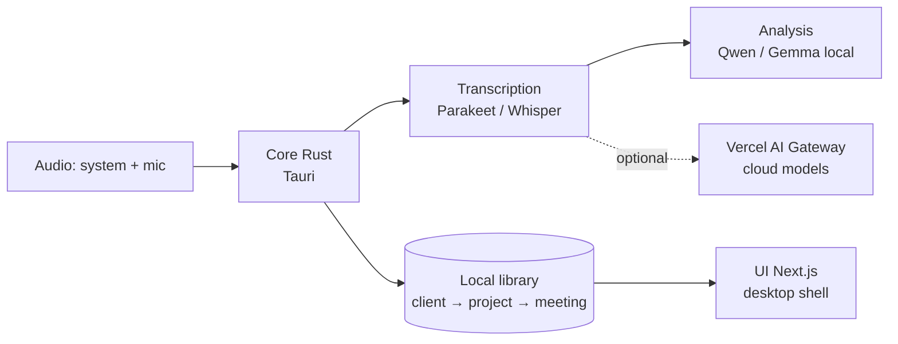

> **Placeholder draft** — this article is under construction. The structure and notes below are a skeleton to fill in with the real content; until then it's hidden from the site (`draft: true`).

## The problem it solves

MeetPulse Desktop exists because meetings generate decisions that get lost. The app captures system and microphone audio, transcribes and summarizes — all local by default, with the cloud as an explicit opt-in.

{/* TODO: real motivation, 1-2 paragraphs. */}

## The 30,000-foot view

{/* TODO: architecture diagram (Excalidraw → SVG in src/assets/blog/meetpulse-desktop/ or inline Mermaid) */}

## The core: Rust + Tauri

{/* TODO:
- Why Tauri over Electron (binary size, memory, native audio access)
- System-audio vs. mic capture in parallel and smart mixing
- Local persistence (SQLite, audio files, semantic search index)
- Release process: .exe/.msi installers, code signing pending */}

## The UI: Next.js + TypeScript

{/* TODO:
- Why Next.js inside Tauri (static SPA served by the shell)
- UI ↔ Rust communication (Tauri commands/events)
- Live transcription state, time-chip navigation, Ctrl+K palette */}

## Local AI first, cloud optional

{/* TODO:
- Local models: Qwen 3.5 2B and Gemma 4 E4B for summary/chat/coach; Parakeet and Whisper for transcription
- Vercel AI Gateway: a single user-owned key, live model list with pricing, ZDR / No Training depending on provider
- The three privacy modes: all local / text only to the cloud / audio and text to the cloud */}

## Decisions and trade-offs

{/* TODO: decision table — e.g. Tauri vs Electron, local vs cloud, Meetily (MIT) as open-source base and what was changed */}

| Decision | Why |
| --- | --- |
| Tauri + Rust | TODO |
| Next.js for the UI | TODO |
| Local-first | TODO |
| Based on Meetily (MIT) | TODO |

## What's next

{/* TODO: macOS and Linux coming soon, installer code signing, audio import (beta) */}
