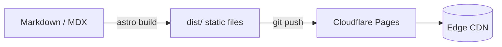

This post is the living example of everything this blog supports: headings and a table of contents, code blocks, tables, an image hosted in `public/`, and a Mermaid diagram. Replace it with your first real article — or keep it as a smoke test.

> There is no database behind this page. Your reading it is a static file being served from an edge.

## Why static-first

Every request that doesn't need compute shouldn't get compute. For a personal site, the whole thing can be built ahead of time and served as files. The trade-offs are boring in the best way:

| Concern | Dynamic app | Static-first |
| --- | --- | --- |
| Latency | App server + DB | CDN edge, ~0ms |
| Cost | Always-on | ~0 |
| Attack surface | Runtime, deps, auth | Files only |
| Content edits | Deploy + cache drama | `git commit` |
| Search | Full-text DB | Pagefind (later) |

## The shape of it

The pipeline is intentionally linear — content goes in, files come out:

<figure>
  
  <figcaption>Figure 1 — One direction of data flow. No runtime database, no CMS.</figcaption>
</figure>

Everything else is detail. When a request *does* need logic (say, a form one day), add it as one small endpoint — not as a reason to re-architect.

## Diagrams when you want them

Mermaid works inline too, for quick architecture sketches:



For anything bigger — sequence diagrams of failure modes, state machines — I export an SVG from Excalidraw and drop it in `public/blog/<slug>/` like the figure above. Both are first-class citizens here.

## A table, because they never go out of style

Still undecided between tools? The boring decision matrix:

| If you want | Reach for |
| --- | --- |
| Long-form writing, zero runtime | Astro content collections |
| Interactivity islands | Astro `client:*` hydration |
| Dynamic OG images | Build-time SVG → PNG |
| Diagrams in markdown | Mermaid (lazy-loaded) |

## Code that ships

Shiki handles syntax highlighting for dual themes out of the box. A taste:

```ts
export const SITE = {
  url: 'https://vicentejorquera.dev',
  email: 'hola@vicentejorquera.dev',
} as const;
```

## What this means in practice

Fewer moving parts, fewer pages to page at 3am. The complexity budget you save here can be spent on the actual product — the writing.
