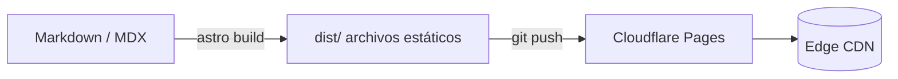

import { Image } from 'astro:assets';
import architectureFlow from '../../../assets/blog/sample-post/architecture-flow.svg';

Este artículo es el ejemplo vivo de todo lo que este blog soporta: encabezados con tabla de contenidos, bloques de código, tablas, una imagen alojada en `public/` y un diagrama Mermaid. Reemplázalo con tu primer artículo real — o déjalo como prueba de humo.

> Detrás de esta página no hay base de datos. Que la estés leyendo es un archivo estático servido desde el edge.

## Por qué static-first

Todo request que no necesita cómputo no debería recibir cómputo. Para un sitio personal, todo puede construirse por adelantado y servirse como archivos. El trade-off es aburrido en el mejor sentido:

| Preocupación | App dinámica | Static-first |
| --- | --- | --- |
| Latencia | Servidor + BD | CDN edge, ~0ms |
| Costo | Siempre encendido | ~0 |
| Superficie de ataque | Runtime, deps, auth | Solo archivos |
| Editar contenido | Deploy + drama de caché | `git commit` |
| Búsqueda | BD full-text | Pagefind (más adelante) |

## La forma de la solución

El pipeline es intencionalmente lineal — entra contenido, salen archivos:

<figure>
  <Image src={architectureFlow} alt="Pipeline de build: markdown en git, build estático con Astro, despliegue al edge de Cloudflare Pages" width={880} height={260} loading="lazy" />
  <figcaption>Figura 1 — Un solo sentido de avance de datos. Sin base de datos en runtime, sin CMS.</figcaption>
</figure>

Todo lo demás es detalle. Cuando un request *sí* necesite lógica (un formulario, algún día), se agrega como un endpoint pequeño — no como excusa para re-arquitectura.

## Diagramas cuando los necesites

Mermaid también funciona inline, para bocetos rápidos de arquitectura:



Para algo más grande — diagramas de secuencia de modos de falla, máquinas de estado — exporto un SVG desde Excalidraw y lo dejo en `public/blog/<slug>/` como la figura de arriba. Ambos son ciudadanos de primera clase aquí.

## Una tabla, porque nunca pasan de moda

¿Aún indeciso entre herramientas? La matriz de decisión aburrida:

| Si quieres | Usa |
| --- | --- |
| Escritura long-form sin runtime | Content collections de Astro |
| Islas de interactividad | Hidratación `client:*` de Astro |
| Imágenes OG dinámicas | SVG → PNG en build |
| Diagramas en markdown | Mermaid (lazy-loaded) |

## Código que se publica

Shiki maneja el syntax highlighting con dual themes out of the box. Una pincelada:

```ts
export const SITE = {
  url: 'https://vicentejorquera.dev',
  email: 'hola@vicentejorquera.dev',
} as const;
```

## Qué significa esto en la práctica

Menos piezas móviles, menos páginas a las cuales entrar a las 3am. El presupuesto de complejidad que ahorras aquí se puede gastar en el producto real — el contenido.
